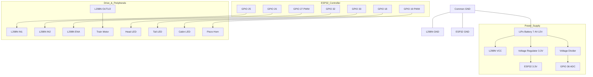

# Train MCU - ESP32 Onboard Locomotive Controller

This project implements an onboard controller for a model train based on the ESP32 microcontroller. It connects to the `train-control` remote unit via WiFi/MQTT to receive commands and report its state.

## 🚀 Features

- **WiFi Connectivity**: Operates as a Station (STA) connecting to the `TrainControl` access point.
- **MQTT Protocol**: 
  - Receives control commands (speed, direction, lights, horn).
  - Publishes real-time state (speed, direction, battery, uptime) with retained messages.
  - Supports "Announce" on connection and Last Will and Testament (LWT) for disconnection.
- **Motor Control**:
  - H-Bridge (PWM) control with configurable acceleration and deceleration ramps.
  - Maximum speed limiting.
  - Hardware E-Stop support.
- **Peripherals**:
  - 3-channel lighting control (Head, Tail, Cabin).
  - Piezo-buzzer horn with variable signal lengths.
- **Monitoring**:
  - Battery voltage monitoring via ADC (0-100%).
  - Periodic state reporting every 2 seconds.
- **Safety**:
  - **Connectivity Watchdog**: Automatically brings the train to a stop if MQTT connection is lost for more than 5 seconds.
  - **Safe Direction Switching**: Direction changes are only allowed when the train is stationary.
- **Configuration**: Persistent storage of Train ID and motor parameters in NVS (Non-Volatile Storage).

## 🔌 Schematic & Connections

### Block Diagram


### Connection Table (L298N Focus)

| L298N Pin | ESP32 Pin | Function |
|:---:|:---:|:---|
| **ENA** | GPIO 27 | PWM Speed Control |
| **IN1** | GPIO 25 | Direction Logic 1 |
| **IN2** | GPIO 26 | Direction Logic 2 |
| **VCC** | Battery (+) | Motor Power (7-12V) |
| **GND** | GND | Common Ground |

## 🛠 Hardware Architecture

| Component | Signal | ESP32 GPIO (Default) |
|-----------|--------|----------------------|
| **Motor (L298)** | IN1 / IN2 / ENA (PWM) | 25 / 26 / 27 |
| **Lights**| Head / Tail / Cabin | 32 / 33 / 18 |
| **Horn**  | Piezo Buzzer (PWM) | 19 |
| **Battery**| Voltage Divider (ADC) | 36 (ADC1_CH0) |

*Note: GPIO pins can be reconfigured in component headers.*

## 📂 Project Structure

- `main/`: Application entry point and system initialization.
- `components/`:
  - `wifi_sta`: WiFi station management.
  - `mqtt_client`: MQTT connectivity and message routing.
  - `motor_driver`: PWM motor control with speed ramping.
  - `light_ctrl`: GPIO-based lighting management.
  - `horn`: Buzzer signal generation.
  - `battery_monitor`: ADC voltage reading.
  - `cmd_handler`: JSON command parsing (cJSON).
  - `state_reporter`: Periodic status telemetry.
  - `train_config`: NVS-based configuration management.

## ⚙️ Building and Flashing

This project uses the **ESP-IDF** (v4.4 or newer) framework.

1. **Set the target** (e.g., esp32, esp32s3, esp32c3):
   ```bash
   idf.py set-target esp32
   ```

2. **Configure the project** (SSID, Password, MQTT Broker IP):
   ```bash
   idf.py menuconfig
   ```
   Navigate to `Train MCU Configuration`.

3. **Build and Flash**:
   ```bash
   idf.py build
   idf.py -p [PORT] flash monitor
   ```

## 📡 MQTT Protocol Summary

- **Commands**: `train/<id>/cmd` (JSON)
- **State**: `train/<id>/state` (JSON, Retained)
- **Announce**: `train/announce` (JSON, LWT)

Refer to `PLAN.md` for detailed JSON schemas.
